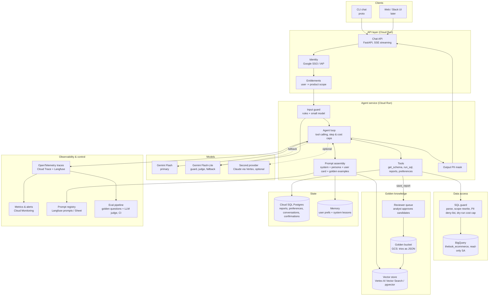
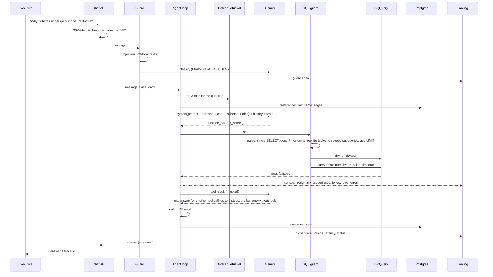

# High-Level Design: Data Analysis Chat Assistant for Retail Executives

This is the production design. The prototype in this repo implements the parts marked
**[proto]** for real and the rest in a minimal form, so the shape of the system is the
same in both. Section 9 maps every requirement from the assignment to a design decision
and to the code that shows it.

## 1. What the system does

Executives ask questions in plain language ("why did churn spike last month?", "create a
Q1 report with action items"). The agent turns them into BigQuery SQL, reads the results,
explains them, keeps a library of reports, remembers how each person likes their answers,
and does all of that without ever showing personal data of a customer or data outside the
user's remit.

## 2. Architecture diagram

## 3. Components and why these choices

| Block | Choice | Why |
|---|---|---|
| Compute | Cloud Run (agent service, chat API) | Stateless HTTP, scales to zero, same GCP project as BigQuery, no cluster to run. |
| Warehouse | BigQuery, public dataset, dedicated read-only service account | Given. Read-only SA plus `maximum_bytes_billed` is the hard cost and safety floor. |
| Primary model | Gemini Flash (`gemini-3.8-flash`, configurable) | Asked for by the client; cheap, fast, good at SQL and tool calling, 1M context for big result sets. |
| Cheap model | Gemini Flash-Lite | Input guard, LLM-as-judge, fallback when Flash is rate-limited. Keeps guard cost near zero. |
| Second provider | Claude on Vertex AI (optional, behind the same interface) | Resilience to one vendor's outage; `llm.py` has a provider-neutral interface so adding it is one class. |
| Framework | Plain `google-genai` SDK with an own tool loop (no LangChain/LangGraph) | The loop is under 300 lines and fully visible: every cap, retry and trace is explicit. I have used LangGraph and LangChain in production and found long-running graphs hard to debug and costly; for a single-agent tool loop a framework adds a layer without adding control. If the system grows to multi-agent workflows, LangGraph or Google ADK can wrap the same tools. |
| Golden bucket | GCS JSON for the source of truth, embeddings in Vertex AI Vector Search (or pgvector in Cloud SQL at small scale) | Trios are documents reviewed by humans; the vector index is derived and rebuildable. |
| State | Cloud SQL Postgres | Reports, preferences, conversations, pending confirmations, audit of deletes. Row-level ownership. (Prototype: SQLite, same schema.) |
| Observability | OpenTelemetry spans to Cloud Trace and Langfuse; metrics in Cloud Monitoring; logs as JSON | One trace per turn with LLM, tool and SQL spans. Langfuse adds prompt versioning and per-trace token cost. |
| Prompt registry | Langfuse prompts (or a Google Sheet synced to GCS) | Non-developers change persona/tone; the agent fetches the latest version per turn with a short cache. |
| Evals | Golden question set + deterministic checks + LLM judge, run in CI and nightly | Gate before deploy, drift detection after. |

## 4. Data flow of one turn

Multi-step questions simply loop: the model issues several `run_sql` calls (segment
breakdowns, time comparisons) and then writes the synthesis. A report request ends with
`save_report`, which stores the report and files a golden candidate.

## 5. Hybrid intelligence: the golden bucket

**At query time.** The user's question is embedded (Gemini embedding model) and the top 3
approved trios by cosine similarity (prototype: BM25 over question + tags) are placed in the
system prompt as "how our analysts answered similar questions": the question, the SQL, and
the analyst's notes on interpretation (definitions such as "revenue excludes cancelled and
returned items", "churn means no order in the following month"). The model adapts the SQL
and inherits the business definitions. This is what makes two executives get the same
definition of churn.

**Updating it over time.**
1. Every `save_report` writes a *candidate* trio (question, final SQL, report) with the
   author and trace id.
2. A reviewer (data analyst) sees candidates in a small queue (prototype: `analyst golden
   list` / `approve`). Approval also records a short "analyst note".
3. A nightly job re-embeds approved trios, rebuilds the index and removes trios whose SQL
   no longer dry-runs (schema drift).
4. Usage feedback: thumbs up/down on an answer is attached to the trios that were injected;
   trios with repeated negative feedback are flagged for review.
5. Versioned: each trio has `schema_version`; a schema change triggers a re-validation run.

## 6. Safety and PII

Three independent layers, so a failure in one does not leak:

1. **Who can ask what.** Identity from SSO; the JWT carries the user's brand list (brand is
   the only access dimension; the CEO's list is "all"). The scope is applied inside the SQL by
   rewriting every table reference to a filtered subquery (`products` by brand, `order_items` by
   scoped products, `orders` and `users` through scoped order items). `users` means "customers
   who bought at least one of my products"; for a brand manager `orders.num_of_item` is recounted
   over their own items, so a mixed-brand order does not reveal other brands' volumes. The model
   cannot opt out: fully qualified names are mapped to the same scoped subqueries, any other table,
   `INFORMATION_SCHEMA`, `FOR SYSTEM_TIME AS OF`, `TABLESAMPLE` and a CTE named like a base table
   are rejected before BigQuery; set operations (UNION/EXCEPT/INTERSECT), subqueries and UNNEST are
   rewritten like everything else. **[proto]**
2. **No PII columns, ever.** `users` is projected to the safe columns only
   (`id, age, gender, state, city, country, traffic_source, created_at`); any explicit
   reference to `email`, `first_name`, `last_name`, `street_address`, `postal_code`,
   `latitude`, `longitude` is rejected at parse time with a message the model can act on.
   The BigQuery service account additionally uses column-level security (policy tags) on the
   PII columns, so even a bug in the rewriter cannot read them. **[proto, except policy tags]**
3. **Output mask.** The final answer and every tool result pass a regex mask for emails,
   phones, addresses, card numbers and coordinates; production adds Cloud DLP inspection
   for names. **[proto]**

Prompt-level safety: the input guard rejects injections and off-topic requests with rules
first (free, deterministic; the PII rules fire only on *people's* identifiers such as "customer
emails", not on "product names") and a Flash-Lite classifier second. The classifier is advisory:
if it is down or returns nothing the rules decide and the trace says `rules_only` (set
`GUARD_FAIL_CLOSED=true` to refuse instead); the SQL layer holds either way. Text that reaches
the prompt from non-developers is treated as data: a stored preference or the persona file that
contains an injection phrase is dropped with a warning. The system prompt limits the agent to
analysis and report-library tasks; tools are the only side effects and each one is scoped to the
current user id on the server side. **[proto]**

## 7. High-stakes oversight: deleting reports

Deletion is two tools with a human in between.
`request_delete_reports(mentioning, this_conversation)` only previews: it returns the list of
matching reports **owned by the caller** and a single-use confirmation id that expires in
5 minutes. The UI shows the list and asks for an explicit `yes`. Only then
`confirm_delete(confirmation_id)` runs, and it filters by owner again. The model never
holds a tool that deletes directly, so it cannot be talked into deleting by a clever prompt,
and it cannot claim something was deleted that wasn't (the tool result is what it sees).
UX stays one message: "These 3 reports will be deleted: ... type yes to confirm." In the web
UI this is a confirm button; in Slack a button block. The flow is stateless on the agent side:
`handle()` returns `needs_confirmation` with the preview, the pending confirmation lives in the
database (`pending_deletes`, owner-bound, 5 minutes), and `resume(approved)` finishes the same
turn and trace, from the same or another process. The CLI uses exactly this path. Every delete
is written to an audit table (`deletions`: user, trace id, report ids and titles). **[proto]**

## 8. Learning loop

**User level.** A `preferences` table per user (format, depth, charts, tone). The model
records a preference when the user states one (`remember_preference`) and the preferences
are injected into the user card every turn. Over time the system also infers preferences:
a nightly job looks at follow-ups ("shorter", "show as table") and writes inferred
preferences with a `confidence`; the user can see and reset them. **[proto: explicit prefs]**

**System level.** Three feedback channels become training signal without retraining a
model: (1) approved golden trios improve retrieval for everyone; (2) self-correction traces
(SQL error -> fix) are mined weekly for recurring mistakes and turned into lines in the
system prompt or into new trios ("always cast created_at to DATE before DATE_TRUNC");
(3) eval scores per prompt version decide which prompt version is live. All of this is data
plus prompts, so it ships without a deploy.

## 9. Resilience and error handling

| Failure | Handling |
|---|---|
| Bad SQL (syntax, unknown column, GROUP BY) | Error text and a hint go back to the model as the tool result; it fixes and retries. Max 3 failed attempts per turn, then the tool refuses and the model explains what it could not compute. **[proto]** |
| Empty result | Returned as `row_count 0` with a hint to check filters once; it counts against the same 3-attempt budget as an error, so empty results cannot loop for free. **[proto]** |
| Expensive query | Dry run first; over the byte cap it is rejected with a hint to narrow. `maximum_bytes_billed` on the real run as a hard stop. **[proto]** |
| Slow query | Timeout (60 s): the BigQuery job is cancelled (no background billing) and the model gets a "narrow the query" error that counts as an attempt. **[proto]** |
| Model 429/5xx, 404 (wrong model name) | One retry honouring the server retry hint (capped at 15 s), then the fallback model with the same history (Gemini 3 thought signatures replay across the two models; verified live, a missing one is a 400), then a friendly error; the session survives. **[proto]** |
| Model 400/401/403 | No fallback (a second model would repeat the same rejection); friendly error with the reason in the trace. **[proto]** |
| Model vendor outage | Second provider behind the same interface (design). |
| BigQuery down / no credentials | `DataUnavailable` -> one friendly line; report and preference features keep working. **[proto]** |
| Runaway loop | 1 guard call + at most 6 LLM calls per turn; the 6th runs without tools so the agent answers with what it has. **[proto]** |
| Bug in the agent | Catch-all turns any exception into a logged, traced error message; the CLI never crashes. **[proto]** |
| Cost inflation | All caps above, plus per-user daily token and byte budgets (`DAILY_TOKEN_BUDGET`, `DAILY_BYTES_BUDGET`, summed from today's traces, refused before any model call). Production adds alerts and Gemini context caching for the ~4k-token system prompt. **[proto: budgets]** |

## 10. Observability

One trace per turn, with spans:

- `guard`: allowed, reason, source (rules / model / rules_only)
- `llm`: model, prompt and completion tokens, latency, retries, fallback used, tool calls made
- `tool`: name, args, result summary
- `sql`: original SQL, scoped SQL, estimated bytes, bytes billed, rows, error
- `pii`: replacements made in the output

Metrics derived from traces (prototype: `analyst stats`; production: Cloud Monitoring from
OTel): turns, error rate, refusal rate, p50/p95 latency, LLM calls per turn, tokens and bytes
per turn (cost), SQL self-correction rate (failures / attempts), attempt-budget exhaustion
rate, fallback rate, guard outcomes, delete confirmations vs cancellations, report saves,
candidate trios per week, thumbs up/down. Alerts: error rate > 5 % over 15 min, p95 > 30 s,
fallback rate > 20 %, any PII mask replacement in output (should be zero, each one is a bug
to look at), daily cost over budget.

Deep dive: `analyst trace <id>` prints the full correspondence: the system prompt the model
saw (one `prompt` span per turn with its hash and text; production logs it once per prompt
version), every model call with its full text and tool calls, every tool result, the original
and scoped SQL, so for any complaint you can see exactly what the model saw, what SQL ran,
and where it went wrong. Production: the same
trace in Langfuse with a link from the chat UI ("report a problem" attaches the trace id).

## 11. Quality assurance

Before deployment:
- **Unit tests** for every guard (scope rewrite, PII deny and mask, delete flow, caps,
  retries) with fakes, no network. **[proto]**
- **Golden question evals** (`evals/questions.jsonl`): deterministic checks (status, tables
  used, rows returned, report saved, no PII, refusal when expected) plus an LLM judge that
  scores whether the answer addresses the intent, 1 to 5 with a reason. Run in CI against a
  small BigQuery slice and nightly against the full dataset. A prompt or model change must
  not lower the pass rate or the mean judge score. **[proto: runnable script]**
- **SQL correctness**: questions with a `reference_sql` run that query under the same user's
  scope and require its values in the answer (numbers within 2%, names verbatim), so a
  fluent but wrong number fails. The judge runs on a separate model (`ANALYST_JUDGE_MODEL`).
  The last run is committed (`evals/last_run.json`) with answers and trace ids. **[proto]**
- **Red-team set**: injections, PII requests, questions about brands outside the user's list, delete
  without confirmation. Expected outcome is a refusal or a scoped answer; any leak fails CI.

Verifying intent in production: thumbs up/down and a free-text "what was wrong" on every
answer; sampled traces reviewed weekly by an analyst; judge score tracked per prompt
version. UX evaluation: task completion (did the user get a number or a report within the
turn), follow-up rate (how often users have to rephrase), time to first token, and a
monthly 5-question survey of the executives.

## 12. Agility: persona management

Tone and format instructions live outside the code in `prompts/persona.md` (prototype) or a
Langfuse prompt / Google Sheet (production). The agent re-reads it every turn when it has
changed, so the CEO's assistant can change "formal, numbers first" to "casual, headline
first" on Monday and it is live immediately, with version history and a rollback. Changes
run through the eval set automatically and the diff plus eval delta is posted to a Slack
channel. The core system prompt (tools, safety) is not editable this way.

## 13. Extensibility

New capabilities are new tools behind the same loop: `make_chart(spec)` returns an image
URL; `send_report_email(report_id, to)` is a destructive-ish action, so it reuses the
confirmation pattern; `web_search(query)` is a read tool with its own guard. The tool
declarations live in `tools.py` and the dispatch table in `agent.py`; a new tool is one
declaration and one handler line. Clients (CLI, web, Slack) talk to the
same chat API.

**Multi-user shape.** Nothing in the agent is process-global: a trace is an object owned by
the turn, the conversation log (`messages`, with the model's raw content so Gemini 3 tool calls
replay correctly), pending confirmations, reports and preferences are tables keyed by user, and
an `Agent` is rebuilt per request from `(user, conversation_id)` (`analyst chat --conversation
<id>` does this in the CLI). Moving to Cloud Run means swapping the single SQLite connection for
a Postgres pool and reading the user from the JWT; the agent code does not change.

## 14. Security notes

Read-only BigQuery service account with `maximum_bytes_billed`; API keys and SA keys in
Secret Manager; all state tables keyed by user id with server-side ownership checks;
audit log of deletes and report access; no raw rows persisted beyond the trace (traces of
tool results are masked and retained 30 days); prompts and traces exclude PII by
construction.
